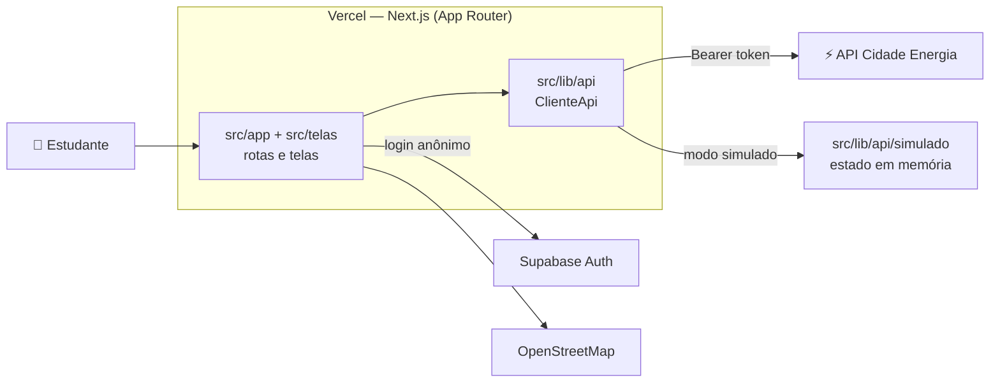

<div align="center">

# ⚡ Cidade Energia — Frontend

<p align="center">
  <strong>"Sua conta de luz é a sua primeira aula de energia."</strong><br>
  PWA do app educacional <strong>Cidade Energia</strong>, criado no Hackathon Equatorial (Desafio 9) para estudantes de escolas públicas de São Luís (MA).
</p>

<p align="center">
  <a href="https://cidade-energia.vercel.app" target="_blank">
    
  </a>
  <a href="https://github.com/Coelho-G-Dev/Cidade-Energia-Back-End" target="_blank">
    
  </a>
</p>

<p align="center">
  
  
  
  
  
  
  
  
  
  
</p>

[Visão Geral](#-visão-geral) •
[Deploy](#-deploy-em-produção) •
[Destaques](#-destaques-de-engenharia) •
[Arquitetura](#-arquitetura) •
[Como Rodar](#-como-rodar-localmente) •
[Telas](#-telas) •
[Testes](#-testes-e-verificação) •
[Roadmap](#-roadmap)

---

</div>

## 🎯 Visão Geral

O **Cidade Energia** ensina energia a partir de algo que todo estudante tem em casa: a conta de luz. Este repositório é **só o frontend**: um PWA em Next.js que consome a API do [backend](https://github.com/Coelho-G-Dev/Cidade-Energia-Back-End).

| Módulo | O que o app faz |
|---|---|
| 💡 **Simulador** | Pela conta de luz ou pelos aparelhos da casa, mostra o gasto, quanto dá para economizar, quantas placas solares a casa precisaria e em quanto tempo elas se pagam. Todos os números são estimativas, e a tela diz isso |
| 📚 **Trilhas** | Lições curtas com quiz, concluídas na ordem |
| 🚲 **Pedale e veja** | Na trilha solar, o estudante gera energia pedalando e vê quais aparelhos conseguiria ligar |
| 🌱 **Missões práticas** | Hábitos para fazer em casa, marcados dia a dia |
| 🗺️ **Mapa** | Pontos de coleta de eletrônicos de São Luís e o ranking de bairros e escolas |
| 🤖 **Tutor Energinho** | Tira dúvidas sobre energia e conta de luz, com links para as lições |
| 🏆 **Perfil** | Pontos, conquistas e a posição da escola e do bairro |

---

## 🌐 Deploy em Produção

O deploy é automático na **Vercel** a cada push na `main`.

- 📱 **App**: [https://cidade-energia.vercel.app](https://cidade-energia.vercel.app)
- 🚀 **API usada em produção**: [https://cidade-energia-back-end.vercel.app](https://cidade-energia-back-end.vercel.app)
- 📖 **Documentação da API (Swagger)**: [https://cidade-energia-back-end.vercel.app/api/docs](https://cidade-energia-back-end.vercel.app/api/docs)

Para publicar um deploy novo do zero:

1. Importe o repositório na Vercel. O preset Next.js e os comandos padrão já servem.
2. Cadastre `NEXT_PUBLIC_SUPABASE_URL`, `NEXT_PUBLIC_SUPABASE_ANON_KEY` e `NEXT_PUBLIC_USAR_DADOS_SIMULADOS=false` em Production e Preview. A URL da API vem do `.env.production`.
3. No projeto do **backend**, inclua o endereço do front no `CORS_ORIGENS` e use **Redeploy** no backend.
4. Confira o CORS:

```bash
curl -s -D - -o /dev/null -X OPTIONS https://cidade-energia-back-end.vercel.app/api/tutor \
  -H "Origin: https://cidade-energia.vercel.app" -H "Access-Control-Request-Method: POST"
```

A resposta precisa trazer `Access-Control-Allow-Origin: https://cidade-energia.vercel.app`.

---

## ✨ Destaques de Engenharia

1. **Privacidade de menores de idade**: o perfil pede só o primeiro nome, o bairro e a escola. A conversa com o tutor fica só na memória da página, e o navegador não guarda dado pessoal além da sessão do Supabase.
2. **Um cliente, dois modos**: a API real e a simulada têm a mesma interface (`ClienteApi`), então as telas não sabem qual estão usando. O modo simulado roda o app inteiro sem backend e sem internet estável.
3. **Pontos só do servidor**: o front nunca envia nem calcula pontos. Mostra o `pontosGanhos` e as `conquistasNovas` que a API devolve.
4. **Contrato espelhado**: `src/types/` copia os tipos de resposta do backend, e `src/lib/validacao/` copia os schemas Zod de entrada, para o front validar os campos do mesmo jeito.
5. **Acessibilidade**: contraste AA, foco sempre visível, alvos de toque de 44 px, rótulo em todo campo e botão de ícone, e o app inteiro funciona só com o teclado.
6. **Movimento com propósito**: animação só na abertura e em resposta a uma ação da pessoa. Com `prefers-reduced-motion`, tudo vira um fade simples.
7. **PWA sem cache da API**: o service worker busca as páginas sempre na rede, tem uma tela própria sem internet e guarda só arquivos estáticos.

---

## 🏗️ Arquitetura



- **Login anônimo:** o front entra direto no Supabase (`signInAnonymously`) e manda o `access_token` em `Authorization: Bearer` em cada chamada. A sessão é reaproveitada: só cria outra se não houver nenhuma.
- **Cliente único:** `src/lib/api/` tem um cliente para a API real e outro para o modo simulado, com a mesma interface. No `401`, o cliente renova a sessão e tenta uma vez de novo.
- **Erros:** as mensagens do backend já vêm em português e vão para a tela. Erros de rede e de sessão têm mensagens próprias (`src/lib/api/erro.ts`).
- **Prévia do simulador:** usa `POST /api/simulacoes/previa`, que nunca salva. Só "Ver meu resultado" salva a simulação.

---

## 🛠️ Stack Tecnológica

| Camada | Tecnologia |
|---|---|
| App | Next.js 16 (App Router), React 19 e TypeScript strict |
| Estilo | Tailwind CSS 4, com tokens em `src/app/globals.css` |
| Animação | Motion 14 (`motion/react`), com tokens em `src/lib/movimento.ts` |
| Mapa | Leaflet com react-leaflet e OpenStreetMap |
| Lições | react-markdown com remark-gfm |
| Login | Supabase JS (só o login anônimo) |
| Validação | Zod 4 |
| Testes | Vitest 5 com Testing Library |
| Deploy | Vercel |

---

## 📂 Estrutura do Repositório

```
src/app/                 rotas (App Router), layout, manifest, ícones e telas de erro
src/app/(publico)/       Boas-vindas e Entrar
src/app/(app)/           telas com a navegação do app
src/app/design/          vitrine dos componentes
src/telas/               o conteúdo de cada tela
src/components/ui/       componentes visuais (botões, campos, cards, azulejo, navegação)
src/components/app/      peças do app (tutor, mapa, celebração de pontos, estados de carga e erro)
src/lib/api/             cliente da API (real e simulado), sessão anônima e erros
src/lib/validacao/       schemas Zod copiados do backend
src/lib/movimento.ts     tokens de movimento e usePoucoMovimento
src/types/               tipos espelhados do backend
public/                  ícones e service worker
tests/                   testes Vitest
```

---

## 💻 Como Rodar Localmente

Requisitos: **Node 24+** e o backend rodando (local ou o de produção).

```bash
npm install
cp .env.example .env.local
npm run dev
```

O app sobe em `http://localhost:3001`. O backend local usa a porta 3000. Preencha o `.env.local`:

| Variável | Para quê |
|---|---|
| `NEXT_PUBLIC_API_URL` | URL da API. Local: `http://localhost:3000`. Produção: `https://cidade-energia-back-end.vercel.app` |
| `NEXT_PUBLIC_SUPABASE_URL` | URL do projeto Supabase (a mesma do backend) |
| `NEXT_PUBLIC_SUPABASE_ANON_KEY` | Chave **pública** (*publishable*) do Supabase. Nunca use a chave secreta no front |
| `NEXT_PUBLIC_USAR_DADOS_SIMULADOS` | `true` roda o app sem backend, com dados simulados (veja abaixo). Padrão: `false` |
| `NEXT_PUBLIC_TURNSTILE_SITE_KEY` | Chave do captcha Cloudflare Turnstile, só se o backend ligar a verificação |
| `NEXT_PUBLIC_MOSTRAR_VITRINE` | `true` abre a vitrine de componentes (`/design`) em produção. Padrão: fechada |
| `NEXT_PUBLIC_MAPA_BLOCOS_URL` | Endereço dos blocos do mapa, com `{z}/{x}/{y}`. Vazio usa o OpenStreetMap |
| `NEXT_PUBLIC_MAPA_ATRIBUICAO` | Texto de atribuição do provedor do mapa (aceita HTML). Vazio usa o do OpenStreetMap |

O backend precisa liberar o endereço do front no `CORS_ORIGENS` dele (por exemplo, `http://localhost:3001`).

O `.env.production` (versionado) só tem a URL pública da API. As variáveis `NEXT_PUBLIC_` entram no código na hora do build: depois de mudar uma delas, rode o build de novo (na Vercel, **Redeploy**).

### 🧪 Modo simulado

Com `NEXT_PUBLIC_USAR_DADOS_SIMULADOS=true`, o app funciona sem backend e sem Supabase. O cliente simulado (`src/lib/api/simulado/`) segue as mesmas regras da API (pontos, lições na ordem, quiz, missões, limites) e usa o conteúdo gerado do seed do backend. O estado fica só na memória da página. Serve para desenvolver telas e para demonstrações sem internet estável.

---

## 📱 Telas

| Rota | Tela | Rotas da API |
|---|---|---|
| `/` | Boas-vindas | — |
| `/entrar` | Criar ou editar o perfil (primeiro nome, bairro e escola) | `GET /api/bairros`, `GET /api/escolas`, `GET` e `PUT /api/perfil` |
| `/inicio` | Início | `GET /api/perfil`, `GET /api/sol-de-hoje`, `GET /api/trilhas`, `GET /api/missoes` |
| `/simulador`, `/simulador/aparelhos` | Simulador pela conta ou pelos aparelhos | `GET /api/aparelhos`, `POST /api/simulacoes/previa`, `POST /api/simulacoes` |
| `/resultado` | Resultado da simulação | `GET /api/simulacoes/ultima` |
| `/trilhas` | Trilhas e missões | `GET /api/trilhas`, `GET /api/missoes` |
| `/trilhas/[slug]/[licao]` | Lição (`continuar` abre a próxima não concluída) | `GET /api/trilhas/{slug}`, `GET /api/licoes/{id}`, `POST /api/licoes/{id}/concluir` |
| `/quiz/[licao]` | Quiz da lição | `GET /api/licoes/{id}/quiz`, `POST /api/quiz/responder` |
| `/pedale` | Pedale e veja | `GET /api/trilhas/energia-solar-em-sao-luis`, `POST /api/pedale/concluir` |
| `/missoes/[id]` | Missão prática | `GET /api/missoes`, `POST /api/missoes/{id}/registrar` |
| `/mapa` | Mapa e ranking | `GET /api/mapa/pontos`, `GET /api/rankings` |
| `/tutor` | Tutor Energinho | `POST /api/tutor` |
| `/perfil` | Pontos e conquistas | `GET /api/perfil`, `GET /api/perfil/resumo`, `GET /api/bairros`, `GET /api/escolas` |
| `/design` | Vitrine dos componentes e estados (fechada em produção) | — |

---

## 🎨 Design e Acessibilidade

- **Identidade:** o padrão de azulejo é a marca do app. Cores, raios, sombras, tipografia e tempos de animação são tokens em `src/app/globals.css` e `src/lib/movimento.ts`.
- **Movimento:** só na abertura e em resposta a uma ação da pessoa. Com `prefers-reduced-motion`, tudo vira um fade simples (`usePoucoMovimento` e `MotionConfig reducedMotion="user"`).
- **Acessibilidade:** contraste AA, foco sempre visível, alvos de toque de 44 px, rótulo em todo campo e botão de ícone, e o app inteiro funciona só com o teclado.
- **Responsivo:** celular, celular deitado, tablet e desktop. No desktop a navegação vira um trilho lateral, e o tutor fica ao lado da lição.
- **Textos:** português simples, na voz ativa, e botões que dizem o que acontece.

---

## 📲 PWA

- `src/app/manifest.ts` com ícones SVG e PNG (192 e 512 px, comuns e recortáveis) e `src/app/apple-icon.png` para o iPhone.
- `public/sw.js` busca as páginas sempre na rede (com uma tela própria sem internet) e guarda só arquivos estáticos. **Nada da API fica em cache.** Ao trocar um ícone, mude `VERSAO` no `sw.js`.

---

## 🔐 Privacidade

O público inclui menores de idade:

- o perfil pede só o primeiro nome, o bairro e a escola. Nada de e-mail, telefone ou documento;
- a conversa com o tutor fica só na memória da página e some ao sair dela;
- o navegador guarda só a sessão do Supabase e dois sinais sem dado pessoal (`ce-abertura-vista` e, no modo simulado, `ce-simulado-logado`).

---

## 🧪 Testes e Verificação

```bash
npm test             # 133 testes Vitest e Testing Library, sem backend
npx tsc --noEmit     # tipos
npm run lint         # ESLint
npm run build        # build de produção
```

Os testes rodam sem backend e sem Supabase: usam o cliente simulado e cobrem as telas, o cliente da API e as regras do modo simulado.

---

## 📦 Scripts Disponíveis

| Comando | O que faz |
|---|---|
| `npm run dev` | Sobe o app em `http://localhost:3001` |
| `npm test` | Roda os testes (Vitest e Testing Library, sem backend) |
| `npm run test:watch` | Testes em modo de observação |
| `npx tsc --noEmit` | Checa os tipos |
| `npm run lint` | Roda o ESLint |
| `npm run build` | Build de produção |
| `npm start` | Sobe o build de produção em `http://localhost:3001` |

---

## 🧭 Decisões

- **Um cliente, dois modos:** a API real e a simulada têm a mesma interface (`ClienteApi`), então as telas não sabem qual estão usando.
- **Lições na ordem:** com sessão, a lição travada continua legível, e o botão de concluir vira um aviso com link para a lição que falta. Sem sessão nada é salvo, então a trava não aparece.
- **Prévia sem salvar:** a estimativa ao vivo espera 400 ms depois do último toque, cancela o pedido anterior e usa a rota que nunca salva.
- **Mapa:** abre enquadrando todos os pontos e se ajusta ao filtro. O provedor dos blocos vem do ambiente; o OpenStreetMap só permite uso leve, então um uso maior pede outro provedor.
- **Vitrine fechada em produção:** `/design` responde "Esta página não existe", a não ser com `NEXT_PUBLIC_MOSTRAR_VITRINE=true`, e nunca é indexada.
- **Estimativas:** todo número do simulador vem da API, e as telas dizem que são estimativas.

---

## 🔮 Roadmap

- [ ] Ativar o **captcha (Cloudflare Turnstile)** no login anônimo, junto com o backend.
- [ ] Trocar o **provedor dos blocos do mapa** se o uso passar do que o OpenStreetMap permite.
- [ ] Mostrar os **pontos solares e as ações reais** no mapa, quando o backend trocar os ilustrativos.
- [ ] Mostrar o **acréscimo da bandeira tarifária** no simulador, quando a API entregar.

---

## 📬 Contato

Projeto desenvolvido para o **Hackathon Equatorial (Desafio 9)**.

📍 **São Luís, MA · Brasil 🇧🇷**

<p align="left">
  <a href="mailto:gabrielbiellosousa@gmail.com">
    
  </a>&nbsp;
  <a href="https://www.linkedin.com/in/gabriel-coelho-7184a32a3/" target="_blank">
    
  </a>&nbsp;
  <a href="https://github.com/Coelho-G-Dev" target="_blank">
    
  </a>
</p>
